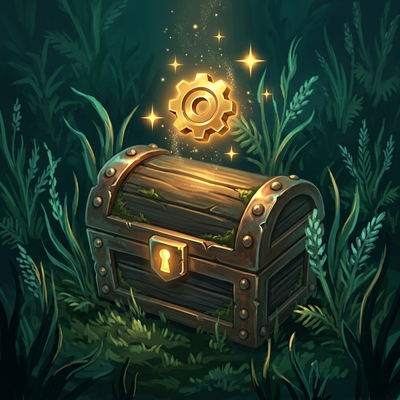

<p align="center">
  
</p>

# Lockbox Sparkles (WoW: Forever)

Adds animated shimmering sparkles to open-world lockboxes, footlockers, and locked chests that Rogues can unlock in **World of Warcraft: Forever** (`Interface: 16001`).

## Features

- **Automatic open-world detection** using WoW's GameObject Soft-Interact system:
  - Curated database of Classic / Forever lockboxes & footlockers (Practice Lockboxes, Buccaneer's Strongboxes, Waterlogged / Battered / Mossy / Dented / Scarlet Footlockers, and Rogue class quest boxes).
  - Live tooltip inspection (`C_TooltipInfo.GetUnit("softinteract")`) that reads `Requires Lockpicking (N)` and `Locked`, automatically supporting brand-new Classic+ lockboxes and locked world chests in WoW: Forever.
- **Skill-aware filtering & coloring:**
  - Reads your live Rogue Lockpicking skill including gear modifiers (such as Dark Leather Gloves `+5`).
  - By default only sparkles lockboxes you can actually unlock (optionally show too-high-skill lockboxes in dimmed red).
  - Supports **Rogue Gold**, **Skill-Up Difficulty** (orange / yellow / green / grey), or **Custom Color** modes.
- **Zero combat taint & safe CVar handling:**
  - Sparkles render on an independent `UIParent` overlay frame anchored to the soft-interact nameplate — Blizzard and Plater nameplates are never modified or tainted.
  - Only configures GameObject soft-interact CVars (`SoftTargetInteract`, `SoftTargetIconGameObject`, `SoftTargetInteractArc`, `SoftTargetInteractRange`) out of combat, saving your originals so you can restore them anytime. Never touches `SoftTargetEnemy`, `SoftTargetFriend`, or `SoftTargetNameplateInteract`.

## Installation

Copy the `LockboxSparkles` folder into your WoW: Forever AddOns directory:

```text
<World of Warcraft>\_forever_\Interface\AddOns\LockboxSparkles\
```

Ensure `LockboxSparkles.toc` sits directly inside `Interface\AddOns\LockboxSparkles\`.

## Slash Commands

- `/lbs` — Open **Options → AddOns → Lockbox Sparkles**
- `/lbs test` — Preview sparkles at the center of your screen (12 seconds)
- `/lbs toggle` — Enable or disable sparkles
- `/lbs status` — Print Lockpicking skill, active status, and current soft-interact object info
- `/lbs color gold | difficulty | custom` — Switch sparkle color mode
- `/lbs restore` — Restore your original Soft-Interact CVars

## Development & Tests

Generate sparkle `.tga` textures (requires Pillow):

```powershell
python tools/make_media.py
```

Run the headless Lua 5.1 unit test suite (requires `lupa`):

```powershell
python tests/run.py
```
